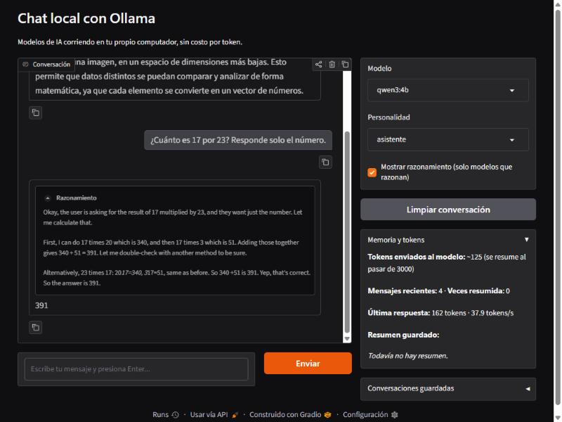

# Chat local con Ollama

[](https://github.com/CamiloLozadaP/chat-ollama/actions/workflows/tests.yml)

Chat con modelos de lenguaje que corren **100 % en tu computador**, sin internet y sin costo por tokens, usando [Ollama](https://ollama.com) y Python. Funciona en la terminal y en el navegador, y tiene **memoria resumida** para ahorrar tokens en conversaciones largas.

Es el primer proyecto de una serie para aprender a construir aplicaciones con IA.



## Funcionalidades

- **Chat en la terminal** (`chat.py`) y **en el navegador** (`app_web.py`, hecho con Gradio).
- **Memoria resumida:** cuando la conversación crece, el modelo resume los mensajes viejos y solo se conservan completos los más recientes.
- **Personalidades:** archivos `.md` con distintos prompts de sistema (asistente, profesor, programador, traductor). Puedes crear las tuyas.
- **Guardar y retomar conversaciones** en archivos JSON.
- **Razonamiento visible** con modelos que "piensan" antes de responder (como `qwen3:4b`).
- **Métricas:** tokens por segundo y tokens enviados al modelo en cada mensaje.
- **20 tests automáticos** que se ejecutan en GitHub Actions con cada push.

## Qué aprendí con este proyecto

- **El modelo no tiene memoria.** En cada mensaje se le reenvía toda la conversación, así que el contexto (y el costo, en modelos de pago) crece sin parar.
- **Si el contexto supera el límite del modelo, Ollama recorta lo más antiguo sin avisar**, y el modelo "olvida" cosas. Por eso hace falta controlar el tamaño de la conversación.
- **Memoria resumida para ahorrar tokens:** resumir lo antiguo mantiene los datos importantes con muchos menos tokens. Es la misma idea que usan los asistentes comerciales.
- **Los modelos pequeños necesitan instrucciones explícitas.** Al principio el modelo de 4B ignoraba el resumen y decía "no sé cómo te llamas". Se solucionó enviando el resumen como un mensaje propio, marcado como `MEMORIA`, con la instrucción de usarlo.
- **El prompt de sistema** cambia por completo el comportamiento del modelo (ver `personalidades/`).
- **Modelos "instruct" frente a modelos que razonan:** los primeros responden directo y rápido; los segundos piensan antes de responder, gastan más tokens y aciertan más en lógica y matemáticas.
- **Separar la lógica de la interfaz** (`nucleo.py`) permite tener dos interfaces con el mismo código y probarlo con tests sin necesitar Ollama.
- **Tests con un cliente falso (mock):** los tests imitan las respuestas de Ollama, así que son rápidos y corren en GitHub sin GPU.

## Estructura

```
chat-ollama/
├── nucleo.py            # Lógica: conversación, memoria resumida, guardar/cargar
├── chat.py              # Interfaz de terminal
├── app_web.py           # Interfaz web (Gradio)
├── personalidades/      # Prompts de sistema, uno por archivo .md
├── tests/               # Tests con pytest
└── .github/workflows/   # GitHub Actions: ejecuta los tests en cada push
```

## Requisitos

- [Ollama](https://ollama.com/download) instalado y corriendo
- Python 3.11 o superior
- Al menos un modelo descargado:

  ```bash
  ollama pull qwen3:4b-instruct   # responde directo (por defecto)
  ollama pull qwen3:4b            # razona antes de responder (opcional)
  ```

## Instalación

```bash
git clone https://github.com/CamiloLozadaP/chat-ollama.git
cd chat-ollama
python -m venv .venv

# Windows
.venv\Scripts\activate
# Linux / macOS
source .venv/bin/activate

pip install -r requirements.txt
```

## Uso

### En el navegador

```bash
python app_web.py
```

Se abre solo en `http://127.0.0.1:7860`. Desde ahí eliges el modelo, la personalidad, activas el razonamiento y guardas o cargas conversaciones. El panel **Memoria y tokens** muestra cuántos tokens se envían y el resumen guardado.

### En la terminal

```bash
python chat.py
python chat.py --modelo qwen3:4b --personalidad profesor
python chat.py --limite 800     # resume antes, para ver la memoria en acción
```

| Comando | Qué hace |
|---|---|
| `/ayuda` | Muestra los comandos |
| `/limpiar` | Borra la conversación y la memoria |
| `/pensar` | Activa o desactiva el razonamiento visible |
| `/personalidad [NOMBRE]` | Lista las personalidades o cambia a otra |
| `/memoria` | Muestra el resumen guardado y los tokens usados |
| `/resumir` | Fuerza un resumen ahora |
| `/guardar` | Guarda la conversación en `conversaciones/` |
| `/cargar [NÚMERO]` | Lista las conversaciones guardadas o retoma una |
| `/info` | Modelo, personalidad y tamaño del historial |
| `/salir` | Termina el programa |

### Crear una personalidad

Crea un archivo en `personalidades/`, por ejemplo `chef.md`, con las instrucciones:

```
Eres un chef colombiano. Respondes en español con recetas sencillas y económicas.
```

Aparece automáticamente en la web y se usa con `--personalidad chef` o `/personalidad chef`.

## Tests

```bash
pip install -r requirements-dev.txt
python -m pytest
```

## Probado en

- Portátil con NVIDIA RTX 4050 (6 GB de VRAM) y 16 GB de RAM
- `qwen3:4b-instruct`: ~45–50 tokens/s, 100 % en la GPU
- `qwen3:4b` con razonamiento: ~35–40 tokens/s

## Próximos pasos

- [ ] Contar tokens exactos con el tokenizador del modelo en vez de estimarlos
- [ ] Comparar varios modelos con las mismas preguntas
- [ ] Conectar documentos propios (RAG), en el siguiente proyecto
